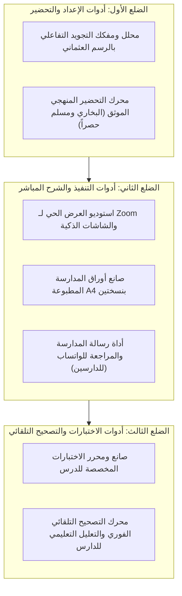

# ۞ مِشكاة | Mishkah — وثيقة الخطة الشاملة والأضلاع الثلاثة لمنظومة المعلم
> **"حقيبة الأدوات المتكاملة للداعية والمعلم الشرعي: إعداد، تنفيذ، وتقييم ذاتي"**  
> وثيقة التخطيط الاستراتيجي المعدلة وفق ميثاق الإتقان والأمانة المهنية.

---

## 🏛️ فلسفة المنصة: الأضلاع الثلاثة لعمل المعلم (The Three Pillars)

البرنامج ليس مكتبة دروس جاهزة ثابتة، بل هو **منصة أدوات ومحركات عمل احترافية** تمكّن المعلم والشارح من أداء دوره في 3 محاور متكاملة:

---

## 🗑️ ما تم حذفه واستبعاده نهائياً من الخطة:
- ❌ **حذف السجلات المدرسية الإلزامية:** إلغاء دفاتر الحضور والغياب ورصد الدرجات التراكمي (فالحلقات العامة يحضرها الكبار والشباب برغبة ذاتية في التعلم).
- ❌ **حذف مراسلات أولياء الأمور:** رسائل الملخصات أصبحت موجهة للدارسين أنفسهم للمراجعة بعد الدرس.
- ❌ **حذف صيغ التأنيث الخاصة:** توحيد كافة النصوص بالصيغة القياسية المعتمدة: "المعلم / المدرس" و "الطلاب / الدارسين".

---

## 🗺️ المراحل التنفيذية المعتمدة (Phased Roadmap)

### 🔹 المرحلة 1: خط النشر السحابي GitHub Pages والتأسيس الهندسي
**الهدف:** إتاحة رابط دائم عبر الإنترنت ومحدث تلقائياً فور اكتمال كل خطوة لتجربته على الهواتف والأجهزة اللوحية دون تشغيل خادم محلي.

1. **إعداد مسار النشر التلقائي (GitHub Actions Workflow):**
   - برمجة ملف `.github/workflows/deploy.yml` لرفع محتوى التطبيق مباشرة على GitHub Pages بنقرة واحدة أو مع كل `git push`.
   - توفير رابط إنترنت عالمي يعمل على الهواتف والأجهزة المختلفة.
2. **محايد العمل في بيئتين (Pure Static + Full Stack Proxy):**
   - ضمان عمل كامل الأدوات في بيئة GitHub Pages الصامتة، مع إمكانية الربط الآمن مع الذكاء الاصطناعي من جانب الخادم أو المتصفح.
3. **تطبيق الويب التقدمي (PWA):**
   - دعم التثبيت المباشر على الشاشة الرئيسية للهواتف وتوفير ميزة العمل بدون إنترنت للدروس التي تم تجهيزها (Offline Support).

---

### 🔹 المرحلة 2: أدوات الضلع الأول (الإعداد والتحضير)
**الهدف:** تزويد المعلم بأدوات تفاعلية قوية لصناعة تحضيره وضبط مادته العلمية بدقة فائقة.

1. **أداة تفكيك وتحليل أحكام التجويد (Interactive Tajweed Analyzer):**
   - إدخال أي آية أو نص قرآني من اختيار المعلم.
   - إبراز النص بالرسم العثماني المشكول مع تلوين فوري لأحكام التجويد (المدود، الإخفاء، الإدغام، القلقلة، الإقلاب).
   - بطاقات مخارج الحروف التشريحية والصفات الصوتية لكل حرف.
   - إمكانية تحرير المعلم للشرح وإضافة أمثلته وتوجيهاته الخاصة.
2. **أداة التحضير المنهجي والتوثيق الصارم (Curriculum Builder):**
   - مسارات العلوم الشرعية (عقيدة، فقه، سيرة، حديث، تفسير، أخلاق).
   - **سياج صحيحي البخاري ومسلم الصارم:** حصر الاستشهاد بالحديث على الصحيحين مع ذكر الراوي ورقم الحديث وبابه، ومنع الأحاديث الضعيفة.
   - صياغة أهداف الدرس، التمهيد المشوق، عناصر الشرح، ونقاط التطبيق العملي في اليوم والليلة.

---

### 🔹 المرحلة 3: أدوات الضلع الثاني (التنفيذ والشرح المباشر)
**الهدف:** تمكين المعلم من إدارة الدرس والشرح بأساليب بصرية مريحة للعين ومؤثرة في الدارسين.

1. **استوديو العرض الحي لـ Zoom والشاشات الذكية (Live Presentation Studio):**
   - وضع ملء الشاشة عالي التباين (High Contrast Presentation Mode).
   - عرض الآيات بالرسم العثماني الكبير بحجم مريح لكبار السن.
   - إمكانية التنقل بين بطاقات الشرح بالأسهم ولوحة المفاتيح.
2. **صانع أوراق المدارسة للطباعة (A4 Print Engine):**
   - تنسيق ورقي فاخر A4 مخصص للطباعة بضغطة زر واحدة.
   - توليد نسختين متطابقتين:
     - **نسخة الطالب:** للتطبيق أثناء الحلقة أو المدارسة المنزلية.
     - **نسخة المعلم:** متضمنة نموذج الحل والتعليل التجويدي أو الفقهي.
3. **أداة ملخص المدارسة الفوري للواتساب (Review Note Broadcaster):**
   - توليد ملخص مركز من 10 أسطر منسق بالإيموجي والتشكيل، موجه للدارسين أنفسهم للمراجعة وتطبيق الأذكار والأحكام.
   - زر نسخ مباشر للإرسال لمجموعة الحلقة.

---

### 🔹 المرحلة 4: أدوات الضلع الثالث (الاختبارات والتصحيح التلقائي)
**الهدف:** تمكين المعلم من وضع أسئلة قياس الفهم، وتمكين الدارس من مراجعة نفسه ذاتياً دون حرج.

1. **صانع ومحرر الاختبارات المخصصة (Quiz Builder Tool):**
   - إمكانية إضافة المعلم لأسئلته الخاصة، أو الاستعانة ببنك الأسئلة الذكي للدرس.
   - أنماط أسئلة متعددة: اختيار من متعدد، صح وخطأ، وتحديد الحكم التجويدي للكلمة.
2. **محرك التصحيح التلقائي الفوري (Auto-Grading & Educational Feedback):**
   - رابط أو واجهة مخصصة للدارس للإجابة على هاتفه.
   - تصحيح تلقائي فوري بمجرد الضغط على "تسليم الإجابات".
   - إظهار التغذية الراجعة والتعليل الصحيح لكل إجابة (لماذا هذا إخفاء؟ وما مخرج الحرف؟ أو ما علة الحكم الشرعي؟).
   - مراجعة ذاتية تحفظ خصوصية الدارس دون إحراج أو إعلان درجات.

---

### 🔹 المرحلة 5: التكامل الميداني والفحص الشامل على الأجهزة
**الهدف:** فحص الأداء وضمان تجربة استخدام سلسة خالية من الأخطاء على كل الشاشات.

1. **فحص التجربة الميدانية عبر GitHub Pages:**
   - تجربة عملية لكافة الأدوات على شاشات الهواتف (iOS و Android) والأجهزة اللوحية (iPads/Tablets) والحواسيب.
2. **مراجعة التوازن البصري وثبات الهيكل والخطوط:**
   - التأكد من ثبات أحجام الخطوط الثلاثة (صغير، متوسط، كبير) وعدم تشوه أي بطاقة أو ترويسة.
3. **الاعتماد النهائي للمنصة:**
   - تسليم منظومة الأدوات متكاملة ومستعدة للاستخدام الحقيقي في الحلقات والمساجد.

---

## 🔄 مسار التنفيذ والمراجعة
- نبدأ فور اعتمادك بتنفيذ **المرحلة 1** (خط الأنابيب و GitHub Pages).
- بمجرد اكتمالها، نرفعها وتتأكد بنفسك من عمل الرابط على هاتفك.
- ثم ننتقل إلى **المرحلة 2** (أدوات الإعداد)، وهكذا مرحلة بمرحلة بتؤدة وإتقان كامل.
