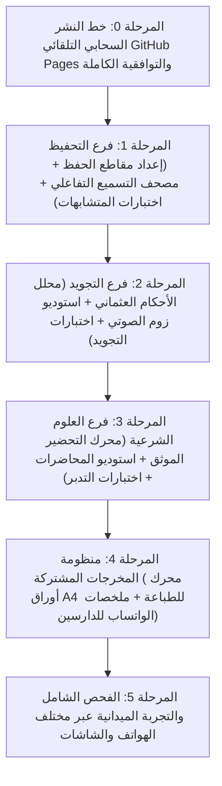

# ۞ مِشكاة | Mishkah — مصفوفة المنظومة الشرعية الشاملة
> **"مصفوفة العمل المتكاملة لمعلم القرآن والعلوم الشرعية (3 فروع شرعية × 3 أضلاع تنفيذية)"**  
> وثيقة التخطيط الاستراتيجي الشاملة والمراحل المعتمدة على ميثاق الإتقان والأمانة المهنية.

---

## 🧭 الهيكل البنائي: مصفوفة المنظومة (3 × 3)

تقوم منصة **مِشكاة** على **3 فروع شرعية مستقلة**، يمتلك كل فرع منها **حقيبة أدواته الثلاثية الخاصة** (إعداد، تنفيذ، اختبارات):

| الفرع الشرعي | 1. أدوات الإعداد والتحضير | 2. أدوات التنفيذ والشرح المباشر | 3. أدوات الاختبارات والتصحيح التلقائي |
| :--- | :--- | :--- | :--- |
| **📖 1. فرع التحفيظ** | تقسيم المقاطع، تبيان غريب الكلمات، وضبط المتشابهات لربط الحفظ. | مصحف التحفيظ التفاعلي (إخفاء/إظهار الآيات للتسميع)، شرائح زوم، وورد الحفظ المطبوع. | اختبارات إكمال الآيات، ترتيب المقاطع، واختبار المتشابهات بتصحيح فوري. |
| **💎 2. فرع التجويد** | تفكيك أحكام التجويد، تلوين الرسم العثماني، وبطاقات مخارج الحروف. | استوديو زوم عالي التباين، تكبير الكلمات الملونة، وأوراق عمل استخراج الأحكام A4. | اختبارات تحديد الحكم، تعليل المخارج، وتصويب أخطاء النطق بتصحيح فوري. |
| **🕌 3. فرع العلوم الشرعية** | بناء المحاضرة، سياج صحيحي البخاري ومسلم، وخطة الدرس بالأهداف والتطبيق. | استوديو زوم للمحاور الشرعية، أوراق المدارسة الفقهية A4، ورسالة الواتساب للدارسين. | اختبارات الفهم والتدبر، قياس الاستدلال، وتصحيح تلقائي فوري مع التعليل الفقهي. |

---

## 🗺️ المراحل التنفيذية المعتمدة (Phased Roadmap)

---

## 📋 تفصيل المراحل الخمس وخطة الإنجاز

### 🔹 المرحلة 0: خط النشر السحابي التلقائي والتأسيس (GitHub Pages Pipeline)
**الهدف:** إتاحة رابط دائم عبر الإنترنت ومحدث تلقائياً فور اكتمال كل مرحلة لتجربته على الهواتف والأجهزة اللوحية دون تشغيل خادم محلي.

1. **إعداد مسار النشر التلقائي عبر GitHub Actions:**
   - ضبط ملف `.github/workflows/deploy.yml` لنشر التطبيق تلقائياً على GitHub Pages مع كل تحديث.
   - توفير رابط حي عالمي يعمل بكفاءة على كافة الهواتف والأجهزة.
2. **محايد العمل الهجين (Static + Full-Stack Proxy):**
   - تمكين عمل كافة الأدوات في بيئة GitHub Pages الصامتة، مع بقاء إمكانية الربط الآمن مع الذكاء الاصطناعي.
3. **تطبيق الويب التقدمي (PWA):**
   - تثبيت فوري على الهواتف والأجهزة اللوحية مع العمل دون إنترنت للحلقات التي لا يتوفر بها اتصال.

---

### 🔹 المرحلة 1: فرع التحفيظ ومدارسة الحفظ (Branch 1: Memorization Tools)
**الهدف:** تزويد معلم حلقة التحفيظ بأدوات تعينه على تيسير الحفظ للدارسين وتثبيته.

1. **أداة إعداد مقطع الحفظ (Memorization Builder):**
   - اختيار السورة والآيات، وتقسيم المقطع إلى أجزاء استيعابية صغيرة.
   - بيان معاني الكلمات الغريبة لربط الحفظ بالفهم الذهني.
   - حصر وتنبيه المعلم بالمتشابهات اللفظية مع سور أخرى لتفادي خلط الآيات.
2. **أداة تنفيذ التحفيظ (Interactive Memorization Studio):**
   - **مصحف التحفيظ التفاعلي لـ Zoom والشاشات:** ميزة إخفاء الآيات تدريجياً (Masking/Reveal) لتسميع الطلاب واختبار ثبات الحفظ على الشاشة.
   - نمط التكرار المرئي وتظليل الكلمة التي يُقرأ عندها.
3. **أداة اختبارات التحفيظ التلقائية (Auto-Graded Hifz Tests):**
   - اختبارات إكمال الآيات الناقصة، ترتيب الكلمات والآيات المبعثرة.
   - أسئلة المتشابهات اللفظية (في أي سورة وردت هذه الزيادة؟).
   - تصحيح تلقائي فوري يظهر للدارس مباشرة على هاتفه.

---

### 🔹 المرحلة 2: فرع التجويد وتصحيح التلاوة (Branch 2: Tajweed Tools)
**الهدف:** تزويد معلم التجويد بأدوات دقيقة لاستخراج الأحكام وشرح المخارج وتقييم الأداء الصوتي.

1. **أداة إعداد وتحليل أحكام التجويد (Tajweed Analysis Engine):**
   - إدخال أي نص قرآني من اختيار المعلم ليُعرض فوراً بالرسم العثماني المشكول (`Amiri Quran`).
   - تلوين الأحكام التجويدية آلياً (المدود، الإخفاء، الإدغام، القلقلة، الإقلاب).
   - بطاقات مخارج الحروف والصفات التشريحية مع إمكانية إضافة المعلم لملاحظاته الخاصة.
2. **استوديو الشرح التفاعلي للتجويد (Live Tajweed Studio):**
   - عرض سينمائي عالي التباين لـ Zoom والشاشات الذكية، مع تكبير الكلمات الملونة بحجم مريح لكبار السن.
   - أزرار تفاعلية لإبراز حكم معين فقط على الشاشة أثناء الشرح (عزل حروف الإخفاء أو المدود).
3. **أداة اختبارات التجويد التلقائية (Auto-Graded Tajweed Tests):**
   - اختبارات استخراج الحكم التجويدي من الكلمات المعروضة.
   - أسئلة تصويب اللحن الخفي واللحن الجلي وأخطاء النطق الشائعة.
   - تصحيح فوري يوضح للدارس علة الحكم ومخرج الحرف.

---

### 🔹 المرحلة 3: فرع العلوم الشرعية المنهجية (Branch 3: Islamic Studies Tools)
**الهدف:** تزويد الداعية والمحاضر بأدوات إعداد وإلقاء دروس الفقه والعقيدة والسيرة والحديث والآداب.

1. **أداة التحضير المنهجي الشرعي (Islamic Lecture Builder):**
   - اختيار المسار: (عقيدة، فقه، سيرة نبوية، حديث، تفسير، أخلاق وآداب).
   - **سياج صحيحي البخاري ومسلم الصارم:** حصر الاستشهاد بالحديث على الصحيحين مع ذكر الراوي ورقم الحديث وبابه الفقهي، ومنع الأحاديث الضعيفة منعاً باتاً.
   - صياغة خطة المحاضرة: التمهيد المشوق، محاور الشرح المبسطة، وتطبيقات عملية في اليوم والليلة.
2. **استوديو إلقاء المحاضرة الشرعية (Live Lecture Studio):**
   - بطاقات عرض مرئية أنيقة ومريحة للعين لمشاركة الشاشة عبر Zoom أو شاشة المسجد.
   - تحكم كامل بالتنقل بين المحاور والعناصر بنقرة زر أو عبر الأسهم.
3. **أداة اختبارات الفهم والتدبر التلقائية (Auto-Graded Islamic Tests):**
   - أسئلة اختيار من متعدد وصح وخطأ حول مفاهيم الدرس ومسائل الفقه والعقيدة.
   - تصحيح فوري يظهر للدارس مع بيان وجه الاستدلال والدليل الشرعي من الآية أو الحديث الصحيح.

---

### 🔹 المرحلة 4: منظومة المخرجات المشتركة (Shared Output Engines)
**الهدف:** توحيد أدوات الطباعة الورقية والبث الرقمي لتخدم الفروع الثلاثة بنسق واحد رفيع المستوى.

1. **صانع أوراق المدارسة للطباعة (A4 Universal Print Engine):**
   - توليد أوراق عمل A4 فاخرة بإطار إسلامي لكل من فروع (التحفيظ، التجويد، والشرعي) بنسختين:
     - **نسخة الدارس:** خالية للتطبيق العملي أثناء الدرس أو في البيت.
     - **نسخة المعلم:** متضمنة نموذج الحل والتعليل والتوجيه.
2. **أداة ملخص المدارسة الفوري للواتساب (Universal WhatsApp Broadcaster):**
   - صياغة ملخص مركز من 10 أسطر منسق بالإيموجي والتشكيل لأي درس (ورد الحفظ، حكم التجويد، أو خلاصة المحاضرة الشرعية).
   - موجه للدارسين أنفسهم للمراجعة بعد الحلقة بنقرة نسخ واحدة.

---

### 🔹 المرحلة 5: التكامل الميداني والفحص الشامل على الأجهزة
**الهدف:** ضمان أعلى درجات الإتقان والاستقرار على كافة أنواع الأجهزة والشاشات.

1. **الفحص الميداني عبر رابط GitHub Pages المباشر:**
   - تجربة كافة الأدوات على الهواتف الذكية (iOS و Android) والحواسيب المحمولة والأجهزة اللوحية.
2. **التحقق من راحة العين وثبات الخطوط الثلاثة (صغير، متوسط، كبير):**
   - التأكد التام من أن الشاشات مريحة لكبار السن والشباب دون أي خلل في أبعاد الصفحة أو تداخل النصوص.
3. **الاعتماد النهائي للمنصة.**

---

## 🔄 مسار الانطلاق
فور موافقتك على هذا التحديد الدقيق، سنشرع فوراً في:
- **المرحلة 0:** تأسيس ملفات النشر التلقائي عبر **GitHub Pages** وتزويدك بالرابط الحي، لنبدأ بعدها بتنفيذ **المرحلة 1 (فرع التحفيظ)** بأدواته الثلاثية.
