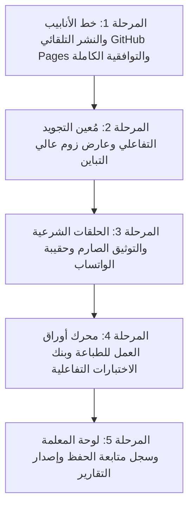

# ۞ مِشكاة | Mishkah — وثيقة الخطة الشاملة وخارطة الطريق المرحلية
> **"نظام التشغيل الشامل للداعية والمعلم الشرعي"**  
> وثيقة التخطيط الاستراتيجي والمراحل التنفيذية المعتمدة على ميثاق الإتقان والأمانة المهنية.

---

## 🌟 الرؤية والرسالة
بناء منصة تقنية شرعية متكاملة ومستقلة، تساند الداعية ومعلم القرآن والعلوم الشرعية بأعلى معايير الإتقان التقني والأمانة العلمية:
- **تقديس النص القرآني بالرسم العثماني الكامل.**
- **التوثيق الشرعي الصارم (صحيح البخاري ومسلم فقط - Zero Weak Hadith).**
- **واجهة مستخدم إسلامية أصيلة، هادئة، ومصممة لراحة عين الشيخ والمعلم وتناسب كبار السن.**
- **النشر التراكمي عبر GitHub Pages للتجربة الحية خطوة بخطوة على مختلف الهواتف والشاشات.**

---

## 🗺️ الهيكل العام للمراحل التنفيذية (Phased Architecture)

---

## 📋 تفصيل المراحل الخمس وخطة الإنجاز

### 🔹 المرحلة الأولى: التجهيز الهندسي وخط النشر السحابي (GitHub Pages Pipeline)
**الهدف:** إتاحة رابط دائم عبر الإنترنت ومحدث تلقائياً فور انتهاء كل مرحلة لتجربته على الهواتف والأجهزة اللوحية دون الحاجة لتشغيل خادم محلي.

1. **إعداد GitHub Pages و GitHub Actions Workflow:**
   - ضبط ملف أتمتة `.github/workflows/deploy.yml` لنشر ملفات `public/` تلقائياً على بيئة GitHub Pages مع كل `git push`.
   - توفير رابط مباشر يعمل على الهواتف فوراً بنطاق GitHub (`https://[username].github.io/mishkah/`).
2. **محايد السيرفر والعمل في وضعين (Universal Hybrid Architecture):**
   - **الوضع الثابت الكامل (Pure Static Mode):** يعمل على GitHub Pages مباشرة وبشكل متكامل باستخدام البيانات المنهجية المدمجة والذكاء الاصطناعي من جانب العميل أو مفتاح الـ API الشخصي المشفر.
   - **الوضع السحابي/المحلي (Full Stack Mode):** يعمل عبر خادم Node.js أو Vercel مع البروكسي الآمن.
3. **اعتماد تثبيت تطبيق الويب التقدمي (PWA):**
   - أيقونة التطبيق الرسمية (`1024x1024`) وشاشات البدء (Splash Screen) لكل من iOS و Android.
   - العمل بدون إنترنت للدروس التي تم تحضيرها (Offline First).

---

### 🔹 المرحلة الثانية: مُعين التجويد التفاعلي وبطاقات زوم (Module A: Tajweed Copilot)
**الهدف:** تحويل حلقة التجويد وتصحيح التلاوة إلى تجربة بصرية تعليمية مبهرة وشديدة الدقة.

1. **قفل الرسم العثماني والتلوين التلقائي للأحكام:**
   - عزل نصوص القرآن بالرسم العثماني (`font-quran` / `Amiri Quran`) مع التشكيل الكامل.
   - ترميز الأحكام بالألوان المعتمدة في مصاحف التجويد:
     - 🔴 **المدود** (أحمر قاني/مرجاني).
     - 🟢 **الإخفاء والغنة** (أخضر زمردي).
     - 🟠 **الإدغام** (برتقالي دافئ).
     - 🔵 **القلقلة** (أزرق فيروزي).
     - 🟣 **الإقلاب** (بنفسجي وقور).
2. **أطلس مخارج الحروف والصفات الصوتية:**
   - بطاقات تفاعلية لمخارج الحروف (الجوف، الحلق، اللسان، الشفتان، الخيشوم).
   - توضيح أخطاء النطق الشائعة وكيفية تصويبها للطلاب.
3. **وضع التدريس والشاشات الكبيرة (Zoom Presentation Mode):**
   - وضع ملء الشاشة عالي التباين بضغطة زر واحدة.
   - بطاقات عرض أفقية مريحة مع أزرار تنقل بالأسهم ومفاتيح الكيبورد لمشاركة الشاشة عبر Zoom أو الشاشات الذكية في المسجد.

---

### 🔹 المرحلة الثالثة: الحلقات الشرعية والتوثيق الصارم وحقيبة الواتساب (Module B)
**الهدف:** إعداد دروس منهجية في العلوم الشرعية تلتزم بصحيح السنة وتوفر محتوى جاهزاً للبث الدعوي.

1. **المسارات المنهجية الستة للدروس الشرعية:**
   - العقيدة، أصول الفقه، السيرة النبوية العطرة، الحديث النبوي الشريف، التفسير الموضوعي، والأخلاق والآداب.
2. **سياج التوثيق الصارم (Zero Weak Hadith Framework):**
   - حصر الاستدلال بالحديث الشريف على صحيحي **البخاري ومسلم**، مع ذكر:
     - نص الحديث مشكولاً.
     - الراوي الصحابي.
     - المصدر (رقم الحديث والباب الفقهي في الصحيح).
   - منع الأحاديث الضعيفة أو الموضوعة أو مجهولة المصدر منعاً باتاً.
3. **خطة الدرس المنهجية للمعلم:**
   - أهداف الدرس السلوكية والوجدانية والمعرفية.
   - تمهيد استهلالي يربط الدرس بواقع الطلاب.
   - عناصر الشرح المبسط بنقاط محددة.
   - أسئلة تدبر وتطبيق حياتي في اليوم والليلة.
4. **حقيبة البث الدعوي الفوري للواتساب (1-Click Broadcast):**
   - ملخص مركز للدرس في 10 أسطر منسقة بالإيموجي والتشكيل.
   - زر نسخ مباشر للإرسال لمجموعات أولياء الأمور وطلاب الحلقة على واتساب وتليجرام.

---

### 🔹 المرحلة الرابعة: محرك أوراق العمل وبنك الاختبارات (Assessment & Print Engine)
**الهدف:** توفير أدوات التقييم والطباعة المباشرة للحلقات الحضورية والاختبارات الذاتية.

1. **أوراق العمل القابلة للطباعة الفورية (PDF & Direct Print):**
   - تنسيق ورقي فاخر مخصص للطباعة مقاس A4 بإطار إسلامي أنيق.
   - توليد نسختين بضغطة زر:
     - **نسخة الطالب:** تحتوي على جداول وأسئلة فارغة للتطبيق العملي.
     - **نسخة المعلم:** تحتوي على الإجابات النموذجية وملاحظات التوجيه.
2. **بنك الاختبارات الذاتية التفاعلية:**
   - أسئلة اختيار من متعدد (MCQ) وصح وخطأ ومطابقة.
   - تصحيح تلقائي فوري مع إظهار التعليل الفقهي والتجويدي للإجابة الصحيحة.
   - إمكانية إجراء الاختبار الذاتي مباشرة من قبل الطالب على هاتفه.

---

### 🔹 المرحلة الخامسة: لوحة المعلمة وإدارة الحلقة وسجل الإنجاز (Dashboard & Tracker)
**الهدف:** تمكين المعلمة والشيخ من إدارة الحلقة ومتابعة تقدم الطلاب وإصدار بطاقات التقرير.

1. **سجل الطلاب ومتابعة الحفظ:**
   - حفظ بيانات الطلاب والحلقات في التخزين المحلي الآمن (`LocalStorage`) لحماية خصوصية الحلقة دون الحاجة لخوادم خارجية معقدة.
   - متابعة تقدم الحفظ والمراجعة وملاحظات التجويد لكل طالب.
2. **بطاقات التقرير الشهري القابلة للمشاركة:**
   - توليد بطاقة شكر وإنجاز شهرية باسم الطالب والدرجات ونقاط التميز.
   - قابلة للتصدير كصورة أو PDF للمشاركة المباشرة مع ولي الأمر.
3. **تصدير واستيراد البيانات (Backup & Restore):**
   - حفظ نسخة احتياطية من سجلات الحلقة بملف JSON أو Excel/CSV.

---

## 🔄 منهجية المراجعة والاعتماد لكل مرحلة

| الخطوة | الإجراء المتخذ |
| :--- | :--- |
| **1. الإعداد والتطوير** | كتابة واختبار الكود والوظائف بما يتوافق مع ميثاق الإتقان. |
| **2. المراجعة الذاتية** | فحص التناسق البصري، ثبات الهيكل، وضوح الخطوط، وظهور الزخارف. |
| **3. النشر إلى GitHub Pages** | رفع التحديث تلقائياً على الرابط الحي ليتسنى لك تجربته على هاتفك وحاسوبك. |
| **4. المراجعة المشتركة والاعتماد** | استعراض ملاحظاتك ومقترحاتك وإقرار المرحلة قبل الانتقال للمرحلة التالية. |
